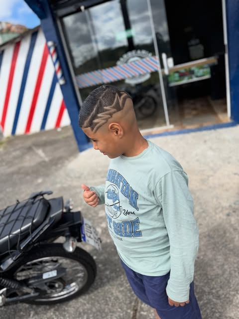

# 💈 Barbearia Gui Leiros — Site Oficial

<p align="center">
  
</p>

<p align="center">
  <b>Site institucional interativo e 3D da Barbearia Gui Leiros</b><br/>
  Rio Grande da Serra — SP · Vila Conde Siciliano
</p>

<p align="center">
  <a href="https://rickdigitalestudio.github.io/barbearia-gui-leiros/">🌐 Site ao vivo</a> ·
  <a href="https://wa.me/5511972179204">📱 WhatsApp (11) 97217-9204</a> ·
  <a href="https://www.instagram.com/barbeariaguileiros/">📸 @barbeariaguileiros</a>
</p>

---

## 📖 Sobre

Landing page de página única (SPA estática) criada a partir das referências reais do Instagram e do
Google Maps da barbearia. Tudo em **HTML + CSS + JavaScript puros**, sem build, sem frameworks e sem
dependências — é só abrir o `index.html` ou hospedar em qualquer servidor estático.

O foco é **conversão via WhatsApp**: cada serviço e cada card levam direto para uma mensagem já
preenchida, reduzindo a fricção para o cliente agendar.

## ✨ Funcionalidades

- **Fundo 3D interativo** em `<canvas>` — malha de partículas douradas que reagem ao cursor
- **Hero cinematográfico** com tipografia de impacto e a frase real da casa
- **Tabela de serviços com filtros** (Cabelo / Barba / Tranças / Infantil) e link de agendamento por serviço
- **Portfólio 3D** — cards com fotos reais que giram em perspectiva no arraste/hover
- **Barbearia pole 3D** animada (CSS puro) na seção "Quem somos"
- **Depoimentos**, **mapa** do endereço real e **botão flutuante** de WhatsApp
- **Menu mobile** responsivo e animações de revelação no scroll (`IntersectionObserver`)
- Paleta **preto + dourado/âmbar**, coerente com a estética urbana dos posts

## 🗂️ Estrutura

```
barbearia-gui-leiros/
├── index.html      # estrutura semântica e conteúdo
├── styles.css      # design system, layout e efeitos 3D
├── app.js          # dados, filtros, galeria, tilt e fundo em canvas
├── img/            # fotos originais do feed (portfolio-1..11.jpg)
└── README.md
```

## 🚀 Rodando localmente

Não precisa instalar nada:

```bash
# opção 1 — direto no navegador
start index.html

# opção 2 — pequeno servidor local
python -m http.server 8000
# depois abra http://localhost:8000
```

## 🌐 Deploy (GitHub Pages)

O site é publicado automaticamente pela branch `main` via **GitHub Pages**:

🔗 [`https://rickdigitalestudio.github.io/barbearia-gui-leiros/`](https://rickdigitalestudio.github.io/barbearia-gui-leiros/)

### Domínio próprio (opcional)

Para usar um domínio como `guileiros.com.br` no futuro:

1. Registre/aponte o domínio no provedor desejado
2. No provedor do DNS, crie os registros:
   - `A` → `185.199.108.153`, `185.199.109.153`, `185.199.110.153`, `185.199.111.153`
   - `CNAME` (para `www`) → `rickdigitalestudio.github.io`
3. Recrie o arquivo `CNAME` na raiz com o domínio (ou configure em *Settings → Pages → Custom domain*)
4. Após a propagação (até 24h), ative **HTTPS** em *Settings → Pages → Enforce HTTPS*

## 👨‍💻 Créditos

**Estúdio:** ESTUDIO RICK DIGITAL
**Cliente:** Guilherme Leiros — Barbearia Gui Leiros
**Contato:** (11) 97217-9204

---

<p align="center">Feito com navalha, café e muito estilo. ✂️</p>
